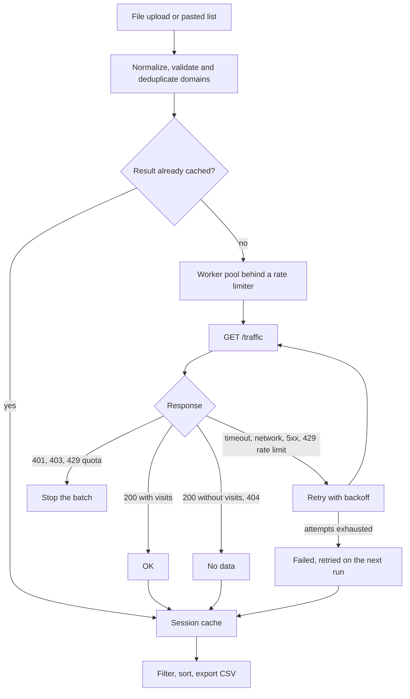

# DataLoom Traffic Checker

A Streamlit app for bulk SimilarWeb traffic lookups through the DataLoom API on RapidAPI. Feed it a list of websites, get monthly visits for each one, filter by a traffic threshold and export the result.

[](https://github.com/adops-tool/streamlit-similarweb-checker/actions/workflows/ci.yml)
[](#getting-started)
[](#usage)
[](LICENSE)

> [!NOTE]
> This project is part of a broader ad-tech lead-generation workflow where candidate domains are filtered by `ads.txt`/`app-ads.txt` signals and traffic thresholds before enrichment.

## Table of Contents

- [Features](#features)
- [How It Works](#how-it-works)
- [Getting Started](#getting-started)
- [Usage](#usage)
- [Configuration](#configuration)
- [Project Structure](#project-structure)
- [Development](#development)
- [Deployment](#deployment)
- [License](#license)
- [Support the Project](#support-the-project)

## Features

**Input**

- Upload a CSV, TSV or TXT file, or paste a list straight into the page.
- Encoding (UTF-8, UTF-16, Windows-1251) and delimiter (`,` `;` tab `|`) are detected automatically.
- Multi-column files are supported: the column holding websites is detected and can be changed, and all other columns are carried over to the export.
- URLs are normalized to bare domains: scheme, credentials, port, path, query, fragment, `www.` and optionally `m.`/`mobile.` prefixes are removed; internationalized names are converted to punycode.
- Rows that do not contain a valid domain are reported and skipped, and duplicates are looked up once, so neither costs quota.

**Lookup**

- Asynchronous requests with a real requests-per-second limit and a cap on parallel connections.
- Timeouts, network errors, HTTP 5xx and rate limiting are retried with jittered exponential backoff; `Retry-After` is honoured.
- A rejected key or an exhausted quota stops the batch immediately instead of failing every remaining domain.
- Results are checkpointed after every response. A stopped or interrupted run resumes where it left off, and failed lookups are retried while resolved domains are never requested twice.
- A previous export can be loaded back to reuse its results in a new session.

**Results**

- Summary counters, a traffic distribution breakdown, a minimum-visits threshold, row filters and sorting.
- `Visits` is a numeric column and `Status` says exactly what happened to each row, so "no traffic data" is never confused with zero or with a failed request.
- CSV export of the current view, with spreadsheet formulas neutralized.

## How It Works



## Getting Started

### Prerequisites

- Python 3.10 or newer
- A RapidAPI account subscribed to the DataLoom SimilarWeb Insights API

### Installation

```bash
git clone https://github.com/adops-tool/streamlit-similarweb-checker.git
cd streamlit-similarweb-checker
python -m venv .venv
source .venv/bin/activate          # Windows: .venv\Scripts\activate
pip install -r requirements.txt
streamlit run app.py
```

To try the app without preparing a list, upload [`examples/domains.csv`](examples/domains.csv).

## Usage

1. Enter your RapidAPI key in the sidebar and, optionally, press **Check key**. The check sends one request for `google.com` and shows the remaining quota.
2. Upload a file or paste a list of websites. The page reports how many rows, unique domains, duplicates and invalid entries were found.
3. For files with several columns, confirm the column that holds the websites.
4. Press **Start lookup**. Progress, the latest result and the estimated time left are shown while the batch runs. **Stop**, like any other interaction with the page, ends the run within a fraction of a second and keeps everything collected so far; only the few requests in flight at that moment are abandoned.
5. Adjust the threshold and filters, then press **Download CSV**. The file matches the table on screen.

### Export format

The export contains the input columns followed by two more:

| Column | Content |
|---|---|
| `Visits` | Monthly visits, empty when unknown |
| `Status` | Outcome for the row, see below |

| Status | Meaning | Looked up again on the next run |
|---|---|---|
| `OK` | Traffic figure received | No |
| `No data` | SimilarWeb has no figure for the domain | No |
| `Invalid domain` | The cell is not a valid domain, no request was made | No |
| `Not checked` | Not requested yet | Yes |
| `Timeout`, `Network error`, `HTTP <code>`, `Rate limited`, `Invalid response` | The request failed, retryable errors after all attempts | Yes |
| `Auth error`, `Quota exhausted` | The API refused the key or the plan ran out of requests; the batch was stopped | Yes |

### Resuming work

Results live in the browser session. Within a session, pressing **Resume lookup** requests only the domains that are still unresolved. To continue in a new session, or on another day, open **Restore previous results** in the sidebar and upload a CSV exported earlier: rows with the status `OK` or `No data` are reused, everything else is looked up again.

### Normalization examples

| Input | Looked up as |
|---|---|
| `https://www.example.com/path?a=1#fragment` | `example.com` |
| `m.news.bbc.co.uk:443/world` | `news.bbc.co.uk` |
| `subdomain.example.com.` | `subdomain.example.com` |
| `bücher.de` | `xn--bcher-kva.de` |

Subdomains other than `www` and the mobile prefixes are kept, because SimilarWeb reports them separately.

## Configuration

### Lookup settings

Available in the sidebar under **Lookup settings**; defaults are defined by `ClientSettings` in [`traffic_checker/config.py`](traffic_checker/config.py).

| Setting | Default | Notes |
|---|---:|---|
| Requests per second | `3` | Keep within the rate limit of your RapidAPI plan |
| Parallel requests | `3` | Upper bound on simultaneous connections |
| Attempts per domain | `3` | Total tries for retryable failures |
| Request timeout | `15` s | Per attempt |
| Treat `m.` and `mobile.` hosts as the main domain | on | Turn off to look up mobile hosts separately |

Inputs are limited to 50,000 rows (`MAX_INPUT_ROWS`) and 10 MB per upload (`.streamlit/config.toml`).

### API key

The key can be typed into the sidebar or provisioned on the server, in which case the field may stay empty:

```bash
export RAPIDAPI_KEY="your-key"
```

or in `.streamlit/secrets.toml`, which is git-ignored:

```toml
RAPIDAPI_KEY = "your-key"
```

A key typed into the sidebar takes precedence over the provisioned one. The key is kept in memory only; it is not written to disk, logged or included in exports.

> [!CAUTION]
> With a provisioned key, everyone who can open the app can spend your quota. Put such a deployment behind authentication.

## Project Structure

```text
.
├── app.py                    # Streamlit UI
├── traffic_checker/
│   ├── config.py             # API endpoint, limits and client defaults
│   ├── models.py             # LookupResult, LookupStatus, Quota
│   ├── domains.py            # URL normalization and validation
│   ├── ingest.py             # File and text parsing, column detection
│   ├── parsing.py            # Extraction of visits from API payloads
│   ├── client.py             # HTTP client: rate limiting, retries, quota tracking
│   ├── batch.py              # Worker pool and early stop on fatal errors
│   └── report.py             # Result table, filters, CSV export and restore
├── tests/                    # Unit tests and end-to-end UI tests
├── examples/domains.csv      # Sample input
├── .streamlit/config.toml    # Server defaults
├── Dockerfile
├── requirements.txt          # Runtime dependencies
└── requirements-dev.txt      # Runtime dependencies plus pytest and ruff
```

The `traffic_checker` package does not depend on Streamlit and can be used on its own:

```python
import asyncio

from traffic_checker.batch import lookup_domains

outcome = asyncio.run(lookup_domains("your-key", ["example.com", "example.org"]))
for result in outcome.results:
    print(result.domain, result.status.label, result.visits)
```

## Development

```bash
pip install -r requirements-dev.txt
pytest
ruff check .
ruff format --check .
```

The tests run against a local stand-in for the API, so they need neither a key nor network access. The same checks run in CI for every push and pull request.

## Deployment

```bash
docker build -t dataloom-traffic-checker .
docker run --rm -p 8501:8501 dataloom-traffic-checker
```

Add `-e RAPIDAPI_KEY=...` to provision a key. The image runs as an unprivileged user and exposes a health check on `/_stcore/health`.

Things to keep in mind for a shared deployment:

- Put the app behind authentication and TLS; Streamlit provides neither on its own.
- Sessions are independent: each browser session has its own key field and result cache.
- Keep the request rate within what the RapidAPI plan allows. Overage on some plans is billed.

## License

This project is licensed under the **MIT License**. See [`LICENSE`](LICENSE) for full terms.

## Support the Project

[](https://www.patreon.com/OstinFCT)
[](https://ko-fi.com/fctostin)
[](https://boosty.to/ostinfct)
[](https://www.youtube.com/@FCT-Ostin)
[](https://t.me/FCTostin)

If you find this tool useful, consider leaving a star on GitHub or supporting the author directly.
